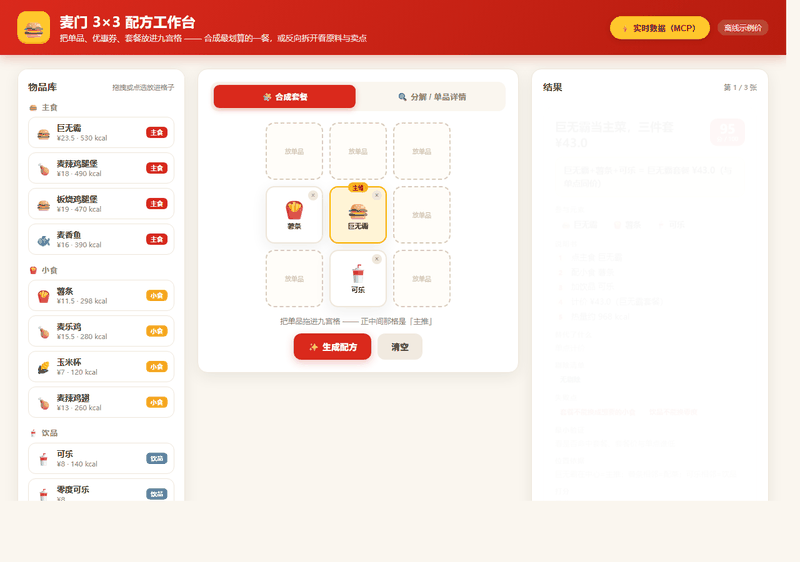

# 麦门 3×3 配方工作台

> 把麦当劳的**单品、优惠券、套餐**放进一个 3×3 九宫格，它会自动帮你：
> - **正向合成**——几个单品怎么点最划算，出一张「套餐 + 价格 + 热量」配方卡；
> - **反向分解**——一个套餐拆成单品，算「单点 vs 套餐」到底哪个省。
>
> 价格、热量、套餐构成都从**麦当劳官方 MCP** 实时拉取，不是写死的示例数字。

<p align="center">
  
</p>

参加麦当劳 1024 程序员创意开发大赛（2026）的作品。

---

## 目录

- [这是什么](#这是什么)
- [它能干什么](#它能干什么)
- [30 秒跑起来](#30-秒跑起来)
- [怎么用](#怎么用)
- [3×3 位置是什么意思](#3x3-位置是什么意思)
- [一张配方卡怎么读](#一张配方卡怎么读)
- [真实数据（麦当劳 MCP）](#真实数据麦当劳-mcp)
- [常用命令速查](#常用命令速查)
- [目录结构](#目录结构)
- [常见问题](#常见问题)
- [比赛交付文件](#比赛交付文件)

---

## 这是什么

它是一个命令行小工具：你给它一组麦当劳的单品（比如「巨无霸 + 薯条 + 可乐」），它通过一套「需求发现 → 关系图 → 候选生成 → 检查器 → 回退 → 排序」的流水线，生成一张**最优配方卡**，告诉你这几样东西怎么点最划算、多少热量、值不值得点套餐。

核心是**换域不改算法**：这套引擎原来是一个「3×3 灵感合成台」（把家里的杂物摆进格子、生成今晚能做的小事），现在只把「数据层」换成了麦当劳（单品/券/套餐 + 真实价格），核心算法一行没动。

---

## 它能干什么

### 1. 正向合成：几个单品怎么点最划算

放进「巨无霸 + 薯条 + 可乐」，它认出这正好是「巨无霸套餐」，然后算：

> 巨无霸三件套 ¥54.5（真实价）—— 跟单点三样同价，不忽悠你说「省了多少」。

放进「麦辣鸡腿堡 + 薯条 + 可乐」，它认出是「麦辣鸡腿堡套餐」：

> 套餐 ¥49 vs 单点 ¥51.5 → **真省 ¥2.5**。

放进「麦旋风 + 可乐 + 苹果派」，它选出「可乐 + 麦旋风」当下午茶（苹果派被剔除），没有对应套餐，就老实说：

> 可乐 + 麦旋风 下午茶 ¥27.5（无对应套餐，按单点计）。

**重点**：这个项目**不编造「总价打八五折」这种假优惠**。有没有「省」、省多少，全靠麦当劳真实套餐价算出来。

### 2. 反向分解：套餐拆开看划不划算

丢一个「巨无霸套餐」进去，它把套餐拆成单品，算价差：

```
单品：巨无霸（单买 ¥29.0）
单品：薯条（单买 ¥14.5）
单品：可乐（单买 ¥11.0）
价差结论：单买总价 ¥54.5 vs 套餐价 ¥54.5 → 价格持平
```

### 3. 位置敏感：同一组东西，换位置配方就变

九宫格**正中间那格 = 主推**。同样是「巨无霸、薯条、可乐」：

- 巨无霸放中间 → 配方主打「巨无霸当主菜」
- 可乐放中间 → 配方变成「可乐当主角」

位置一变，主辅反转，配方措辞就跟着变。这就是「3×3」的意义：位置本身就是一种输入。

---

## 30 秒跑起来

**要求**：Python 3.10 或更高（项目只用标准库，不需要 pip 装任何东西）。

```bash
# 1. 进入项目目录
cd mcd-recipe-workbench

# 2. 直接跑一遍演示（不需要任何密钥，离线也能跑）
python run.py --demo
```

你会看到 5 个内置场景，每个场景出一张配方卡。这就是全部核心功能。

> 想用**真实价格/热量**？看下一节 [真实数据（麦当劳 MCP）](#真实数据麦当劳-mcp)。

---

## 怎么用

### 方式 A：交互式（最直观，推荐新手）

```bash
python run.py
```

回车后：

1. 先列出所有可用单品/券/套餐（19 个）；
2. 列 5 个内置场景，选一个（回车默认第一个）；
3. 出一张配方卡；
4. 然后可以输入：
   - `换一个` —— 看合格池里下一张卡
   - `就这个` —— 收藏进正样本库
   - `标记` —— 反馈「有惊喜 / 一般 / 扯」
   - `再生成一批` —— 重新生成
   - `退出` —— 结束

### 方式 B：命令指定（适合演示/写进脚本）

```bash
python run.py --scenario 巨无霸薯条可乐     # 跑指定场景
python run.py --decompose 巨无霸套餐        # 反向拆解套餐
python run.py --closure 巨无霸套餐          # 分解 → 再合成闭环
python run.py --ablation shuffled           # 位置消融：打乱位置看配方变不变
python run.py --my-recipes                  # 打印收藏的「我的配方」
```

---

## 3×3 位置是什么意思

九宫格每个位置有语义（这就是「位置敏感」的来源）：

| 位置 | 含义 |
| --- | --- |
| 正中间 `2,2` | **主推**（谁放中间谁当主角） |
| 相邻（上下左右） | **搭配**（主菜的配菜/饮品等） |
| 对角 / 边角 | **点缀 / 约束**（次要位置） |

其余格子的角色由单品类别决定：主食 = 主菜、小食 = 配菜、饮品 = 饮品、甜品 = 甜品、券 = 优惠。

所以「巨无霸@2,2 薯条@2,1 可乐@3,2」的意思就是：**巨无霸放中间当主推，薯条、可乐在旁边当搭配**。

---

## 一张配方卡怎么读

以「巨无霸薯条可乐」离线演示的输出为例：

```
【一句发现】巨无霸当主菜，三件套 ¥43.0
【这是什么】巨无霸+薯条+可乐 = 巨无霸套餐 ¥43.0（与单点同价）
【替代了什么】单点计价
【参与元素】巨无霸 + 薯条 + 可乐
【剔除清单】（没有）
【说明书】
    1. 点主食 巨无霸
    2. 配小食 薯条
    3. 加饮品 可乐
    4. 计价 ¥43.0（巨无霸套餐）
    5. 热量约 968 kcal
【最小验证】看是否命中套餐、套餐价与单点谁低
【失败点】套餐不能换成想要的小食；饮品不能换零度
【位置依据】巨无霸在中心=主推；薯条相邻=配菜；可乐相邻=饮品
【可行性】feasible    【分数】95/100
```

| 字段 | 说明 |
| --- | --- |
| 一句发现 | 一句话概括（≤30 字），主推不同措辞就不同 |
| 这是什么 | 具体是什么组合、多少钱、有没有省钱 |
| 替代了什么 | 它替代了「单点计价」这个更笨的做法 |
| 参与元素 | 这次用到了哪几个单品/券 |
| 剔除清单 | 没用到的东西，以及为什么不用的理由 |
| 说明书 | 一步步怎么做 |
| 最小验证 | 怎么验证这个配方值不值 |
| 失败点 | 这个配方的坑（比如套餐不能换小食） |
| 位置依据 | 每个格子起的角色作用 |
| 分数 | 6 项打分（需求/惊喜/替代/可做/说明书/位置）加总 |

> 上面的 ¥43.0 / 968 kcal 是**离线占位示例值**（README 顶部说清楚了）。接上麦当劳 MCP 后，这里会变成真实价（如巨无霸套餐 ¥54.5）。

---

## 真实数据（麦当劳 MCP）

「MCP」是麦当劳开放的一套官方数据接口（菜单、价格、优惠券、营养等）。接上它，配方卡里的价格/热量/套餐构成就是**真实门店数据**。

```bash
# 1. 设置 Token（只放环境变量，绝不写进代码）
#    Windows（PowerShell）:
$env:MCD_MCP_TOKEN = "你的Token"
#    Windows（cmd）:
set MCD_MCP_TOKEN=你的Token
#    macOS / Linux:
export MCD_MCP_TOKEN=你的Token

# 2. 加 --live 跑
python run.py --live --demo
python run.py --live --scenario 巨无霸薯条可乐
python run.py --live --decompose 麦辣鸡腿堡套餐
python run.py --live --city 上海市 --keyword 外滩   # 换城市/门店
```

跑 `--live` 时会先打印一行「麦当劳 MCP 实时数据已接入 · 某某门店」，列出它拉到的真实菜单数、热量数、套餐构成、真实计价验证、门店可用券。

- **Token 从哪来**：麦当劳 MCP 的访问凭证，需自行申请。
- **不设 Token 会怎样**：`--live` 会提示降级为离线示例数据，不会报错崩溃。

详细接入说明见 [MCP_INTEGRATION.md](MCP_INTEGRATION.md)。

---

## 常用命令速查

| 命令 | 作用 |
| --- | --- |
| `python run.py --demo` | 非交互跑全部 5 个示例（离线占位价） |
| `python run.py` | 交互式：选场景、换卡、标记反馈 |
| `python run.py --scenario 名字` | 跑指定场景 |
| `python run.py --decompose 名字` | 反向拆解一个单品/套餐 |
| `python run.py --closure 名字` | 分解 → 再合成闭环 |
| `python run.py --ablation shuffled` | 打乱位置看配方是否变化（验证位置敏感） |
| `python run.py --my-recipes` | 打印收藏的「我的配方」 |
| `python run.py --live --demo` | 接麦当劳 MCP 跑真实数据（需 Token） |
| `python run.py --verbose` | 打印完整流水线（需求/关系/位置/回退日志） |

内置场景：`巨无霸薯条可乐`、`可乐薯条巨无霸·主辅反转`、`满30减5券巨无霸可乐`、`薯条免费券薯条可乐`、`麦旋风可乐苹果派`。

---

## 目录结构

```
mcd-recipe-workbench/
├── run.py                      # 命令行入口
├── config.yaml                 # 配置（生成器/流水线参数/MCP 地址）
├── recipe/                     # 引擎
│   ├── schema.py               # 数据模型（Item/Slot/配方卡…）
│   ├── catalog.py              # 目录：19 个单品/券/套餐 + 券规则
│   ├── templates.py            # 合成引擎：单品类别 × 格子角色 → 候选
│   ├── needs.py                # 需求发现
│   ├── relations.py            # 关系图
│   ├── checker.py              # 检查器：8 条硬指标
│   ├── scoring.py              # 6 项打分
│   ├── position.py             # 位置语义（中心=主推…）
│   ├── pipeline.py             # 流水线编排（生成→检查→回退→排序）
│   ├── generator.py            # 生成器接口（规则版 / DeepSeek 可插拔）
│   ├── feedback.py             # 反馈回流（正/负样本库）
│   ├── negative_samples.py     # 负样本库
│   ├── decomposition.py        # 反向分解
│   ├── closure.py              # 分解→再合成闭环
│   ├── mcp_client.py           # 麦当劳 MCP 客户端（纯标准库）
│   └── live.py                 # 实时数据层（门店→菜单→营养→券→计价）
├── data/                       # 运行时生成的反馈/样本（不提交）
├── MCP_INTEGRATION.md          # MCP 接入说明
├── mcp-config.example.json     # 脱敏配置示例
└── CONTEST_DECLARATION.md      # 参赛声明
```

---

## 常见问题

**Q：我跑 `--demo` 看到的价钱怎么和麦当劳 App 不一样？**
A：`--demo` 是离线占位示例价（README 和卡片顶部都标了）。想看真实价，设 `MCD_MCP_TOKEN` 后加 `--live`。

**Q：`--live` 报「未设置 MCD_MCP_TOKEN」？**
A：说明你没设环境变量。设好 Token 再跑，或者不设 Token 用离线模式。

**Q：为什么有的套餐显示「省 ¥2.5」，有的显示「与单点同价」？**
A：这是真实结果，不是 bug。麦当劳不是所有套餐都比单点便宜——麦辣鸡腿堡套餐确实省 ¥2.5，巨无霸套餐价格等于单点。项目**不编造优惠**。

**Q：需要装什么依赖吗？**
A：不用。核心引擎和 MCP 客户端都用 Python 标准库，零第三方依赖。可选：把生成器换成 DeepSeek 时才需要设 `DEEPSEEK_API_KEY`。

---

## 比赛交付文件

- `README.md` —— 项目介绍与使用（本文件）
- `CONTEST_DECLARATION.md` —— 参赛声明（官方原文）
- `MCP_INTEGRATION.md` —— MCP 接入说明
- `mcp-config.example.json` —— 脱敏配置示例（仅环境变量占位符）
- `recipe/`、`run.py`、`config.yaml` —— 源码
